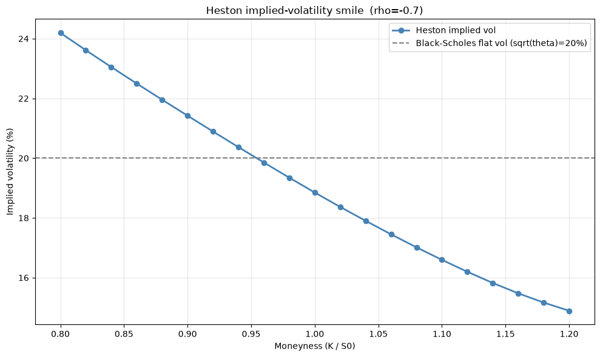

# Heston stochastic-volatility simulation

Simulate Heston stock and variance paths, price European options by Monte Carlo and recover Black–Scholes implied-volatility smiles.

**The saved negative-correlation experiment gives implied volatility 24.19% at strike 80 and 14.89% at strike 120.** These are simulated prices, not a market calibration.



## Quick start

From the repository root; no market data or credentials are needed:

```bash
python3 -m venv .venv
.venv/bin/pip install -r requirements-dev.txt
.venv/bin/python -m pytest -q
```

`python -m src.heston` prints a seeded price comparison. `python -m src.smile` calculates a new model smile. The README chart is extracted from the existing notebook by `python scripts/export_chart.py`, without re-executing notebook cells.

## Method

- Correlated Gaussian increments drive stock and variance innovations.
- Log-Euler updates keep stock prices positive.
- Full truncation clamps variance used in drift and diffusion; stored variance can remain negative.
- Discounted simulated payoffs estimate European call and put prices.
- Brent inversion maps call prices into Black–Scholes implied volatility.
- Notebook experiments vary correlation and volatility of volatility.

## Results

The [saved notebook](notebook/01_heston_model.ipynb) uses spot 100, rate 3%, initial and long-run variance 0.04, reversion speed 2, volatility of volatility 0.5, correlation −0.7 and one-year maturity. It simulates 50,000 paths. Its displayed strike/volatility outputs support the quoted skew; the notebook experiment was not rerun during cleanup.

## What didn't work

The notebook's Feller condition is violated, and simulated variance can cross zero. Clamping helps computation but does not establish discretization accuracy. The previous claim that the time grid guaranteed roughly 0.01 price precision was unsupported and removed. TODO: time-step convergence and a characteristic-function or exact-scheme comparison. There is no calibrated market study or trading result.

## Tests, structure and licence

[](https://github.com/VChahar1/heston-simulation/actions/workflows/tests.yml)

Eight tests pass, covering initial values, positive stock paths, mean reversion, small-vol-of-vol behavior, parity and smile inversion. `src/` contains simulation, pricing and plotting; `tests/` contains numerical checks; `notebook/` retains the ordered study. Code: [MIT](LICENSE).
